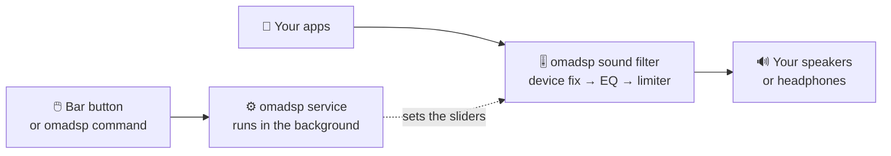

<h1 align="center">
  <br>
  <a href="https://github.com/sudharamachandranrajeev/omadsp"></a>
  <br>
  omadsp
  <br>
</h1>

<h4 align="center">Make everything your Omarchy computer plays sound better: an equaliser for all apps, controlled from the bar.</h4>

<p align="center">
  
  
  
  
</p>

<p align="center">
  <a href="#-what-it-will-do">What it will do</a> •
  <a href="#-where-it-stands">Where it stands</a> •
  <a href="#-how-it-works">How it works</a> •
  <a href="#-faq">FAQ</a> •
  <a href="#%EF%B8%8F-for-developers">For developers</a>
</p>

<p align="center">
  
</p>

omadsp is a system-wide sound equaliser for [Omarchy](https://omarchy.org), in the spirit of
Poweramp on Android. It shapes the sound of every app at once, and you control it from a button
in the bar. It uses the sound system already on your computer (PipeWire), with no extra audio
app. Status: **in development, not usable yet**. There is no app or user interface so far, so
the picture above is a design diagram, not a screenshot.

## ✨ What it will do

- 🎚️ **One equaliser for everything** – browsers, music players and games all go through it.
  Change the sound once, not in every app.
- 🎛️ **Easy or detailed** – simple sliders, or up to 32 precise bands (parametric EQ), plus bass
  and treble.
- 🎧 **Tuned per device** – each set of headphones or speakers gets its own settings, with
  correction curves from the [AutoEq](https://github.com/jaakkopasanen/AutoEq) library.
- 🔇 **Never distorts** – it lowers the level ahead of a boost and adds a safety limiter, so
  loud parts never crackle (clip). A light shows if a song still overloads.
- 🤫 **No clicks or gaps** – drag a slider, switch presets or turn it off while music plays,
  without a pop.
- 🅰️ **Before / after** – hold A/B to hear the difference.
- 🛟 **Safe by design** – switched off or flat, the sound is untouched. If omadsp crashes, the
  music keeps playing.
- 🔭 **Later** – stereo width, crossfeed for headphones, virtual speakers, reverb and
  bit-perfect output.

## 🚦 Where it stands

There is nothing to install yet. The project is built in phases, and each phase is planned and
approved before work starts.

| Phase | What it delivers | State |
| --- | --- | --- |
| 0 | Research and test runs: does the design hold up? | ✅ Done ([findings](https://github.com/sudharamachandranrajeev/omadsp/blob/phase1-daemon/docs/2026-10-12-phase0-findings.md)) |
| 1 | The background service (daemon) and the `omadsp` command | 🔨 In progress on the [`phase1-daemon`](https://github.com/sudharamachandranrajeev/omadsp/tree/phase1-daemon) branch: code written, tests under way |
| 2 | The bar button and panel: power, presets, EQ, tone, limiter, overload light, A/B | Planned |
| 3 | Detailed EQ with a response curve, AutoEq library, settings per device | Planned |
| 4 | Space and effects: balance, width, mono, crossfeed, virtual speakers, reverb | Planned |
| 5 | Output: sample rate, bit depth, Bluetooth codec, bit-perfect mode | Planned |
| 6 | Package and install guide | Planned |

This `main` branch holds the plan. The code lives on `phase1-daemon` until Phase 1 is done.

## 🧭 How it works



- **The sound filter** sits between your apps and your speakers. It follows whichever device is
  the default, and leaves alone any app that you sent to a different device.
- **It runs in its own process.** If it fails, the design lets the sound fall through straight
  to the device.
- **The background service** holds your presets and moves the sliders. It never rebuilds the
  filter while you listen, so nothing clicks.
- **Your volume keys still work** as before. They act on the device, after omadsp.

In tests the equaliser and limiter used under 1 % of one CPU core and added 5 ms of delay.

## ❓ FAQ

<details>
<summary><b>Can I use it today?</b></summary>

Not yet. Phase 1 builds the background service and a command-line tool. The bar button comes in
Phase 2. Watch this repository for the first release.
</details>

<details>
<summary><b>Will it mess up my sound setup?</b></summary>

It is designed not to. It never makes itself the default device and never moves apps between
devices. Every file it writes outside the project carries a "Managed by omadsp" header, and it
refuses to overwrite files it did not create. Off or flat, the goal is sound that is
bit-for-bit unchanged.
</details>

<details>
<summary><b>Why not EasyEffects or JamesDSP?</b></summary>

omadsp uses PipeWire's own filter system and the bar that Omarchy already runs. There is no
second audio server and no separate window to keep open.
</details>

<details>
<summary><b>What will it need?</b></summary>

Omarchy 4, PipeWire 1.6.6 or newer, WirePlumber 0.5 and the `lsp-plugins-lv2` package (the
equaliser and limiter come from [LSP Plugins](https://lsp-plug.in)).
</details>

## 🛠️ For developers

<details>
<summary>Build and test the Phase 1 code</summary>

You need [Git](https://git-scm.com), [Rust](https://www.rust-lang.org) 1.85 or newer, PipeWire
1.6.6 or newer and `lsp-plugins-lv2`.

```bash
git clone https://github.com/sudharamachandranrajeev/omadsp
cd omadsp
git switch phase1-daemon   # the daemon code lives here for now

cargo build                # omadsp-core library, omadspd daemon, omadsp command
cargo test                 # unit and golden-file tests
```

- `UPDATE_GOLDEN=1 cargo test -p omadsp-core --test golden` rewrites the graph golden files in
  `tests/golden/`. Review the diff.
- The integration tests (`tests/integration/*.sh`) and the Phase 0 spikes (`spikes/`) play only
  into a private silent sink (`omadsp_spike_out`). Nothing reaches your speakers or default device.
- The diagram above is [docs/architecture.html](docs/architecture.html), screenshotted at
  1600 × 760.

</details>

<details>
<summary>Key design decisions from Phase 0</summary>

* **ADR-1** Targetless WirePlumber smart filter, never the default sink.
* **ADR-2** The filter-chain runs in a separate `pipewire -c` host process supervised by `omadspd`: crash isolation decides.
* **ADR-3** LSP `para_equalizer` in APO mode, not builtin biquads (they click on every change); flat or unused bands are switched off.
* **ADR-4** Fixed topology `omadsp` → `pre` (x16) → `eq` (x32) → `lim` → `omadsp_out`; dips, A/B and on/off without reloads (a reload costs ~0.1 s plus a click).
* **ADR-5** LSP `limiter_stereo`, last, always on while the DSP is on (−1 dBTP default).
* **ADR-6** No Poweramp-style DVC in v1: Omarchy's volume keys, OSD and slider always act on the device, after the DSP.
* **ADR-7** Overload LED from a hand-linked passive capture on `omadsp_out`.
* **ADR-8** Spatial via the SOFA spatializer with calibrated gain; the HeSuVi example is not shipped.
* **ADR-9** Node names `omadsp` / `omadsp_out`; both opt out of WirePlumber state restore.
* **ADR-10** Validate every graph input; on a filter error, stop the host so audio falls through to the device.
* **ADR-11** NDJSON IPC, CLI and plugin as in PROMPT.md.

Measured in Phase 0: LSP EQ + limiter used 0.27–0.66 % of one core, with 5.0 ms added latency
(7.6 ms with true peak), which is the limiter's lookahead.

</details>

**Documents:**
[PROMPT.md](PROMPT.md) (goals, feature map, architecture and phases) ·
[Phase 0 plan](docs/2026-10-12-phase0-plan.md) ·
[Phase 0 findings](https://github.com/sudharamachandranrajeev/omadsp/blob/phase1-daemon/docs/2026-10-12-phase0-findings.md)
(test results, decisions, risks and the Phase 1 plan)

<details>
<summary>Credits</summary>

- [PipeWire](https://pipewire.org) filter-chain and [WirePlumber](https://pipewire.pages.freedesktop.org/wireplumber/) smart filters
- [LSP Plugins](https://lsp-plug.in) (`para_equalizer`, `limiter_stereo`) via LV2
- [pipewire-rs](https://gitlab.freedesktop.org/pipewire/pipewire-rs), [serde](https://serde.rs), [anyhow](https://github.com/dtolnay/anyhow)
- [Omarchy](https://omarchy.org) and [Quickshell](https://quickshell.org) for the bar plugin
- [AutoEq](https://github.com/jaakkopasanen/AutoEq) (planned headphone correction library) and [Poweramp](https://powerampapp.com) for the inspiration

</details>

## License

No licence has been chosen yet; all rights reserved.

---

> GitHub [@sudharamachandranrajeev](https://github.com/sudharamachandranrajeev)
