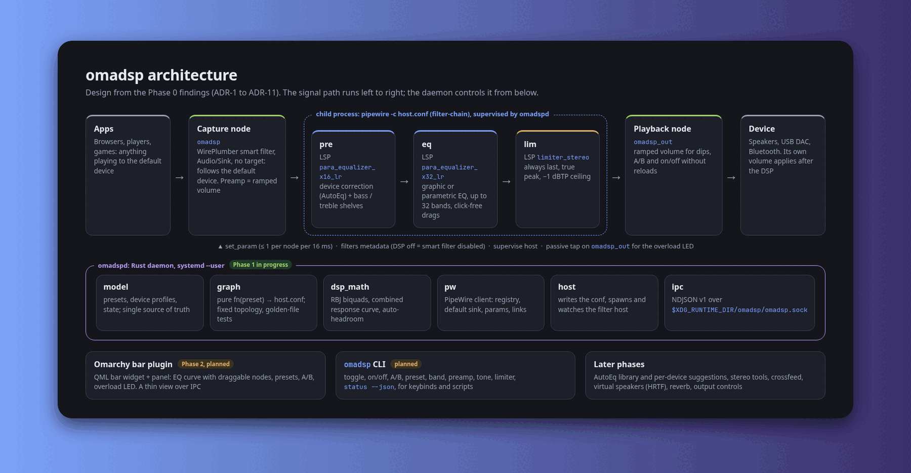

<h1 align="center">
  <br>
  <a href="https://github.com/sudharamachandranrajeev/omadsp"></a>
  <br>
  omadsp
  <br>
</h1>

<h4 align="center">A Poweramp-style, system-wide audio DSP for Omarchy: PipeWire's own filter-chain, a Rust daemon, and a bar plugin.</h4>

<p align="center">
  
  
  
  
  
</p>

<p align="center">
  <a href="#key-features">Key Features</a> •
  <a href="#how-to-use">How To Use</a> •
  <a href="#download">Download</a> •
  <a href="#credits">Credits</a> •
  <a href="#related">Related</a> •
  <a href="#license">License</a>
</p>

<p align="center">
  
</p>

> **Work in progress, not usable yet.** omadsp has no user interface so far, so the image above is an
> **architecture diagram**, not a screenshot (source: [docs/architecture.html](docs/architecture.html)). Phase 0
> (research and spikes) is done; Phase 1 (the daemon core) is being built on the
> [`phase1-daemon`](https://github.com/sudharamachandranrajeev/omadsp/tree/phase1-daemon) branch. `main` holds the
> build prompt and the Phase 0 plan.

## Key Features

What omadsp is designed to do (from [PROMPT.md](PROMPT.md) and the
[Phase 0 findings](https://github.com/sudharamachandranrajeev/omadsp/blob/phase1-daemon/docs/2026-10-12-phase0-findings.md)):

* **Transparent and safe** – with the DSP flat or off, output is bit-identical to no DSP; it never clips, never hijacks app routing, and audio keeps playing if the daemon dies.
* **Native** – PipeWire filter-chain in a WirePlumber smart filter for audio, a systemd user service for the daemon, an Omarchy bar plugin (QML) for the UI. No EasyEffects, JamesDSP or extra audio server.
* **Follows your device** – a targetless smart filter that tracks the default output; streams that target another device are left alone.
* **Click-free EQ** – graphic or parametric EQ, up to 32 bands per channel, on LSP `para_equalizer` (PipeWire's builtin biquads click on every change).
* **Device correction and tone** – an AutoEq layer per device plus bass / treble shelves.
* **Never clips** – automatic headroom preamp and an LSP true-peak limiter, always last (−1 dBTP default).
* **Glitch-free A/B and on/off** – a fixed graph topology with ramped volume dips, so nothing you drag causes a reload.
* **Overload LED** – from a daemon-side tap on the filter output.
* **Poweramp-grade UX (planned)** – bar widget and panel with a draggable response curve, presets per device, AutoEq library with suggestions, A/B hold.
* **Later phases (planned)** – stereo tools (balance, width, mono), crossfeed, virtual speakers (HRTF), reverb, volume leveler, output controls and bit-perfect mode.

<details>
<summary><b>Key decisions from Phase 0</b></summary>

* **ADR-1** Targetless WirePlumber smart filter, never the default sink.
* **ADR-2** The filter-chain runs in a separate `pipewire -c` host process supervised by `omadspd`: crash isolation decides.
* **ADR-3** LSP `para_equalizer` in APO mode, not builtin biquads; flat or unused bands are switched off.
* **ADR-4** Fixed topology `omadsp` → `pre` (x16) → `eq` (x32) → `lim` → `omadsp_out`; dips, A/B and on/off without reloads (a reload costs ~0.1 s plus a click).
* **ADR-5** LSP `limiter_stereo`, last, always on while the DSP is on.
* **ADR-6** No Poweramp-style DVC in v1: Omarchy's volume keys, OSD and slider always act on the device, after the DSP.
* **ADR-7** Overload LED from a hand-linked passive capture on `omadsp_out`.
* **ADR-8** Spatial via the SOFA spatializer with calibrated gain; the HeSuVi example is not shipped.
* **ADR-9** Node names `omadsp` / `omadsp_out`; both opt out of WirePlumber state restore.
* **ADR-10** Validate every graph input; on a filter error, stop the host so audio falls through to the device.
* **ADR-11** NDJSON IPC, CLI and plugin as in PROMPT.md.

Measured in Phase 0: LSP EQ + limiter used 0.27–0.66 % of one core, with 5.0 ms added latency (7.6 ms with true
peak), which is the limiter's lookahead.

</details>

## How To Use

There is nothing to install yet. To follow development you'll need [Git](https://git-scm.com),
[Rust](https://www.rust-lang.org) 1.85+, PipeWire 1.6.6+ and `lsp-plugins-lv2`:

```bash
# Clone this repository (private)
$ git clone https://github.com/sudharamachandranrajeev/omadsp

# Go into the repository
$ cd omadsp

# Switch to the branch with the daemon code
$ git switch phase1-daemon

# Build the workspace (omadsp-core library + omadspd daemon) and run the unit and golden-file tests
$ cargo build
$ cargo test
```

* Golden files for the graph generator live in `tests/golden/`; `UPDATE_GOLDEN=1 cargo test -p omadsp-core --test golden` rewrites them (review the diff).
* Integration tests (`tests/integration/*.sh`) and the Phase 0 spikes (`spikes/`) run only on a private null sink
  (`omadsp_spike_out`): nothing reaches the speakers or the default device.
* The project is phase-gated: each phase is planned and approved before it is built, and nothing is written outside
  the repo without showing the diff first ([PROMPT.md §2](PROMPT.md)).

## Download

No downloads yet. The plan is to ship the daemon as a separate package (PKGBUILD) and the bar plugin through
Omarchy's plugin system, which documents the daemon as a dependency.

## Credits

omadsp builds on:

- [PipeWire](https://pipewire.org) filter-chain and [WirePlumber](https://pipewire.pages.freedesktop.org/wireplumber/) smart filters
- [LSP Plugins](https://lsp-plug.in) (`para_equalizer`, `limiter_stereo`) via LV2
- [pipewire-rs](https://gitlab.freedesktop.org/pipewire/pipewire-rs), [serde](https://serde.rs), [anyhow](https://github.com/dtolnay/anyhow)
- [Omarchy](https://omarchy.org) and [Quickshell](https://quickshell.org) for the bar plugin
- [AutoEq](https://github.com/jaakkopasanen/AutoEq) (planned headphone correction library) and [Poweramp](https://powerampapp.com) for the inspiration

## Related

* [PROMPT.md](PROMPT.md) – the build prompt: goals, feature map, architecture and phases
* [docs/2026-10-12-phase0-plan.md](docs/2026-10-12-phase0-plan.md) – Phase 0 recon and spike plan
* [Phase 0 findings](https://github.com/sudharamachandranrajeev/omadsp/blob/phase1-daemon/docs/2026-10-12-phase0-findings.md) – spike results, ADRs, risks and the Phase 1 plan

## License

No licence has been chosen yet; all rights reserved.

---

> GitHub [@sudharamachandranrajeev](https://github.com/sudharamachandranrajeev)
